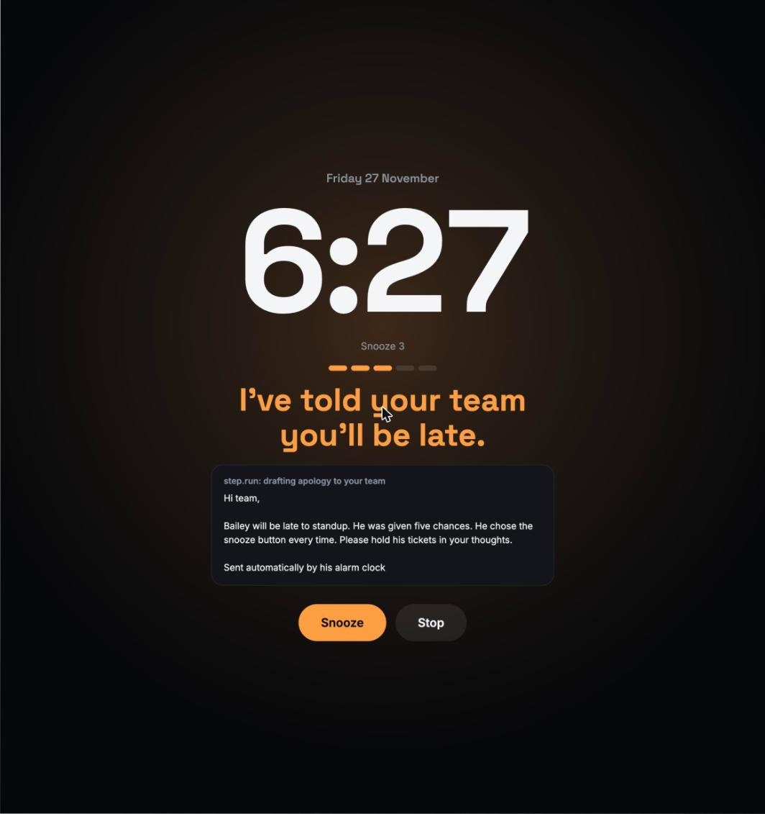

# Angry Alarm

An alarm clock that gets angrier every time you snooze.

Snooze once and it's disappointed. Snooze three times and it emails your team to say you'll be late. Snooze five times and it texts your mum, posts on X, pings Slack #general, emails your manager and renames today's standup to "Bailey overslept".

It's a joke, but the workflow is real. Every ring, snooze and consequence is a durable [Inngest](https://inngest.link/12-days-bailey) step, so you can watch the whole thing escalate in the Inngest run view.

Built for Inngest's **[12 Days of Workflows build-a-thon](https://inngest.link/12-days-bailey)**.



## How it works

One Next.js app. The alarm UI and the Inngest functions live in the same repo and deploy together.

The main workflow is [`inngest/functions/angry-alarm.ts`](inngest/functions/angry-alarm.ts):

1. **Triggers.** A cron at `TZ=Australia/Brisbane 0 6 * * *` (6am every day), plus an `alarm/start` event so the UI can start it on demand. `singleton: { mode: "cancel" }` means a new alarm cancels any alarm that is still ringing.
2. **`step.run("generate-alarm-id")`** creates the alarm's id.
3. **`step.sleep("get-in-position")`** waits a few seconds when started from the UI, so you can press Space and walk into frame.
4. For each level from 0 to 5:
   - **`step.realtime.publish("ring-level-N")`** pushes `{ level, status: "ringing", message, displayTime }` to the browser over **Inngest Realtime**. The UI renders only from these messages, with no polling and no database.
   - **`step.waitForEvent("wait-for-response-N")`** waits for an `alarm/action` event for this alarm, **with a timeout**. A `dismiss` ends the run. A `snooze` counts as a snooze. A timeout (`null`) means you slept through it, which also counts as a snooze.
   - **`step.sleep("snooze-N")`** is the snooze itself.
5. **Level 3:** `step.run("draft-apology-email")` writes the apology and `step.run("send-apology-email-to-team")` sends it. The text is published to the UI, where it types itself out.
6. **Level 5:** **`step.sendEvent("fan-out")`** sends five events. Each starts its own small function with its own run in the dashboard ([`inngest/functions/consequences.ts`](inngest/functions/consequences.ts)):
   - `consequence/text-mum`
   - `consequence/post-x`
   - `consequence/slack-general`
   - `consequence/email-manager`
   - `consequence/rename-standup`

   Each one publishes `sending`, waits for a `dramatic-pause`, does its job, then publishes `done`. The UI ticks them off as they finish.

The displayed time is the first ring plus 9 minutes per snooze, like an iPhone (6:00, 6:09, 6:18…). That's for display only. The real wait is the snooze duration.

### Safe by default

Nothing is sent for real unless you set the env vars for that integration. If they're missing, the step logs `[mock]` and returns `{ mode: "mock" }`. If they're set, it sends for real and returns `{ mode: "real" }`. Either way you can see which happened in each step's output.

| Consequence | Real integration | Needs |
|---|---|---|
| Apology email to team | Resend | `RESEND_API_KEY`, `RESEND_FROM`, `TEAM_EMAIL` |
| Email manager | Resend | `RESEND_API_KEY`, `RESEND_FROM`, `MANAGER_EMAIL` |
| Slack #general | Incoming webhook | `SLACK_WEBHOOK_URL` |
| Text mum | Twilio | `TWILIO_ACCOUNT_SID`, `TWILIO_AUTH_TOKEN`, `TWILIO_FROM`, `MUM_PHONE` |
| Post on X | Mock only (TODO) | |
| Rename standup | Mock only (TODO) | |

## Modes

| Setting | `filming` | `real` |
|---|---|---|
| Start delay | 8s | 0s |
| Ring timeout | 20s | 2m |
| Snooze duration | 4s | 9m |

`ALARM_MODE` sets the defaults for the cron and for events that don't override them. If it's unset, the default is `real`, so the 6am cron behaves like a real alarm. The UI always sends its own settings with `alarm/start`. Change them in the hidden panel (press **H**).

## Controls

| Key | Action |
|---|---|
| Space | Idle: start the alarm (after the delay). Ringing: snooze. |
| Enter / D | Stop |
| R | Reset the screen |
| F | Fullscreen |
| H | Settings panel (delay, ring timeout, snooze length, displayed times, sound) |
| L | Step log overlay |

On a phone, tap the screen to start the alarm. Browsers block audio until you interact with the page, so the first Space or tap also unlocks the sound. The beeps are generated with Web Audio, so there are no audio files.

## Local setup

Requires [Bun](https://bun.sh).

```bash
bun install
cp .env.example .env.local   # INNGEST_DEV=1 is already set
bun run dev:all
```

- App: http://localhost:3000
- Inngest dev server: http://localhost:8288 (open **Runs** to watch the alarm escalate step by step)

`dev:all` runs `next dev` and the Inngest dev server together via `concurrently`. The Inngest SDK v4 defaults to cloud mode, so `INNGEST_DEV=1` is required locally.

## Env vars

See [`.env.example`](.env.example).

| Var | Purpose |
|---|---|
| `INNGEST_DEV` | `1` locally, to use the dev server |
| `INNGEST_EVENT_KEY`, `INNGEST_SIGNING_KEY` | Production keys for Inngest Cloud (the Vercel integration sets them) |
| `ALARM_MODE` | `filming` or `real` (default `real`) |
| `RESEND_*`, `TEAM_EMAIL`, `MANAGER_EMAIL` | Optional real email |
| `SLACK_WEBHOOK_URL` | Optional real Slack post |
| `TWILIO_*`, `MUM_PHONE` | Optional real SMS. Leave unset unless you mean it. |

## Deploy (Vercel + Inngest Cloud)

1. Push to GitHub and import the repo in Vercel. Bun is detected from `bun.lock`.
2. Install the [Inngest Vercel integration](https://vercel.com/integrations/inngest). It sets `INNGEST_EVENT_KEY` and `INNGEST_SIGNING_KEY` and syncs `https://<your-app>/api/inngest` on every deploy. You can also set the keys yourself and sync the URL in the Inngest dashboard.
3. Optional: set `ALARM_MODE` and any integration env vars.
4. Redeploy, open the live URL and press Space.

## Known quirk

`waitForEvent` only sees events sent after it starts waiting. If you press snooze within a fraction of a second of the ring appearing, the press can be missed. The ring then times out, which counts as a snooze anyway. The alarm doesn't mind.

## License

MIT
